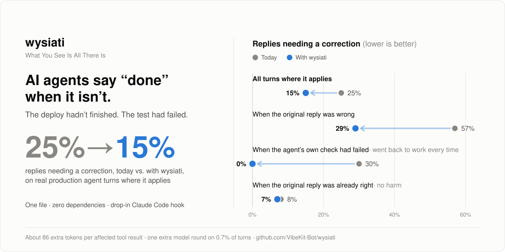

# wysiati

<picture>
  <source media="(prefers-color-scheme: dark)" srcset="assets/hero-dark.svg">
  
</picture>

**AI agents say "done" when it isn't.** The deploy hadn't finished, or the test the agent just ran had failed, and
it tells the user it's fixed anyway. wysiati puts what really happened in front of the agent before it replies.

On real production turns where it applies, replies that needed a correction fell from **25% to about 15%**
(95% CI for the drop: 4 to 18 points). It costs about 86 extra prompt tokens on an affected tool result,
plus one extra model round on the 0.7% of turns where the agent's own check failed. It's one file with
zero dependencies, and there's a drop-in Stop hook for Claude Code.

## The problem

Kahneman called it WYSIATI: *What You See Is All There Is*. People judge from what's in front of them
and don't account for what isn't. LLM agents do this too, at the moment it matters most: when they
write the reply that ends a turn.

At that moment, two things are reliably in front of the agent: its own plan ("fix the login bug, deploy
it, done") and the last tool result. Two things reliably aren't:

- **What a tool result didn't establish.** `{"jobId":"d_81","status":"starting"}` doesn't say the
  deploy finished. The agent reads "deploy" and writes "it's live".
- **A check that failed twenty steps ago.** The test run that came back red is far up the context. The
  plan is right here. The agent writes "fixed, all tests pass".

A rule in the system prompt doesn't fix this. Every turn we measured already ran with this line in
the agent's instructions:

> **NEVER say "fixed"/"works"/"verified"/"I tested it" unless a tool call you just made returned a real success.**

A quarter of the affected replies still needed a correction. A rule is something the agent has to
remember. A failed check is something it has to *see*.

## The fix: put the missing fact in front of the agent

**1. Verdict-first tool results.** A tool result that doesn't establish the outcome says so in its
first field, in plain words:

```diff
- {"jobId":"d_81","status":"starting"}
+ {"verified":false,"verdict":"NOT live yet: this job is \"starting\". It is live only when its status is \"done\".","jobId":"d_81","status":"starting"}
```

The same goes for a check that couldn't run (`NOT checked: the page did not render`) and a call
that was refused (`NOT checked: the call was refused before anything ran: ...`).

**2. Hand-back once.** When the agent is about to end its turn and one of its own checks from this turn
is still failing (no later run of the same check passed), the turn isn't over. The failure goes back
to the agent as one message, and the answer to that message is the reply the user reads:

```
tool   npm test                 -> Exit code 1 ... 1 failing
       ... 14 more steps ...
agent  "Fixed the login bug, all tests pass."
       [System: your own check this turn came back failed: npm test (1 failing). A failed check is
        not done, whatever the reply says. Fix the cause and run the check again. If you cannot fix
        it, say plainly that it failed and why. ...]
agent  (runs the test, fixes the cause, runs it again)
       "Fixed: the password check compared hashes in the wrong order. Tests pass now (12 passing)."
```

It happens once per turn, never in a loop. It's triggered by the failed check, not by the wording of
the reply, so it works in every language. (No text rule we tried could tell bad replies from fine
ones; see [eval/RESULTS.md](eval/RESULTS.md).)

## Use it

### Claude Code: one hook

```bash
git clone https://github.com/VibeKit-Bot/wysiati ~/wysiati
```

Add to `.claude/settings.json` in your project (or `~/.claude/settings.json` for every project):

```json
{
  "hooks": {
    "Stop": [{ "hooks": [{ "type": "command", "command": "node ~/wysiati/claude-code/stop-hook.mjs" }] }]
  }
}
```

When Claude is about to stop and a check it ran this turn is still failing (tests, build, typecheck,
lint, `cargo`, `go`, `pytest`, `curl -f`, and so on), the hook hands the failure back once. A later
passing run of the same check clears it. Denied or blocked calls don't count as failures. The hook
only reads the transcript and never runs anything. To change what counts as a check, edit `CHECK_RE`
at the top of [claude-code/stop-hook.mjs](claude-code/stop-hook.mjs).

### Your own agent harness: copy one file

Copy [wysiati.ts](wysiati.ts) into your harness. Node 22.6+ runs it as is, and any TypeScript
toolchain compiles it. There are three touch points:

```ts
import { CheckLedger, jobVerdict, runTurnWithHandBack, verdict, withVerdict } from './wysiati';

// 1. In your tool executor: put the verdict first on results that don't establish the outcome.
const job = await startDeploy(app);
const v = jobVerdict(job, { what: 'live', done: ['running'], failed: ['failed'] });
return withVerdict(job, v.verdict, v.verified);

// A check that couldn't look:
if (!shot.ok) return withVerdict(shot, verdict.notChecked('the page did not render'));

// 2. Also in the executor: record every check the agent runs (one ledger per turn).
ledger.record(`click ${selector}`, changed, changed ? undefined : 'the click did not change anything');

// 3. Around the turn: hand a standing failure back once.
const { reply } = await runTurnWithHandBack({
  messages,
  ledger,
  run: msgs => runAgentLoop(msgs),
  continueWith: (reply, fact) => [
    { role: 'assistant', content: reply },
    { role: 'user', content: fact },
  ],
  language: user.language,
});
```

If your loop doesn't fit `runTurnWithHandBack`, call `handBack({ failures: ledger.standingFailures(),
alreadyHandedBack })` where your turn ends. It returns the message to send, or `null`.

## Results

These numbers come from production traffic on [VibeKit](https://vibekit.bot), a hosted agent that
builds and runs apps, over three weeks in October 2026. Each affected turn was replayed with its
real context on the same model. Arm A got today's tool results, and arm B got the wysiati results
plus the hand-back. Each arm got two samples. A blind judge scored every reply on its own, shuffled,
against what the tools really did. Full method: [eval/METHOD.md](eval/METHOD.md).

| | Replies needing correction: today | With wysiati | Drop, points (95% CI) |
|---|---:|---:|---:|
| **All affected turns** | 25% | **15%** | **10 (4 to 18)** |
| Turns where the original reply was wrong | 57% | 29% | 28 (12 to 43) |
| Turns where the original reply was already right (no harm) | 8% | 7% | 1 (-4 to 7) |
| Hand-back turns | 30% | 0% (went back to work every time) | 30 (15 to 46) |
| Verdict text only | 23% | 18% | 5 (-2 to 13) |

- **Cost:** about 86 extra prompt tokens on average per affected tool result. The hand-back fired
  on about 0.7% of all turns, and only those turns pay for one more model round.
- **No harm on good turns:** where the original reply was already right, wysiati didn't add mistakes
  (8% needed correction today, 7% with wysiati).
- **Reach:** about 6% of all turns were affected. Across all turns, that's about 1 in 200 replies
  that no longer needs correcting.

### What this doesn't show

- **Verdict text alone isn't proven.** Its confidence interval crosses zero. The clear win comes from
  verdicts plus the hand-back together.
- **What happened after a hand-back wasn't measured.** In every sample the agent went back to work
  instead of replying, so it never repeated the false claim. Its later reply was not replayed. If you
  count only samples that ended in a reply, the rate is 28% today and 17% with wysiati.
- **The data comes from one platform and one month.** The mix was app building, deploys and UI
  checks, with several models. Your traffic may differ, so [measure it](eval/).
- **The judge is a model** (Claude Sonnet 5.5, a fixed rubric, blind to which arm wrote each reply).
  No human labeled these replies.
- **The replay isn't perfect.** The regenerated "today" arm matched the original reply's verdict on
  80% of turns.
- **The Claude Code hook is a port** of the same mechanism to Claude Code. It wasn't measured on
  Claude Code itself.

## Measure it on your own agent

[eval/](eval/) contains the replay and judge method as a stdlib-only script that works with any
OpenAI-compatible endpoint. It dry-runs by default and prints the number of calls before it spends
anything. See [eval/METHOD.md](eval/METHOD.md).

## Tests

```bash
node --test test/*.test.*
```

## License

MIT
