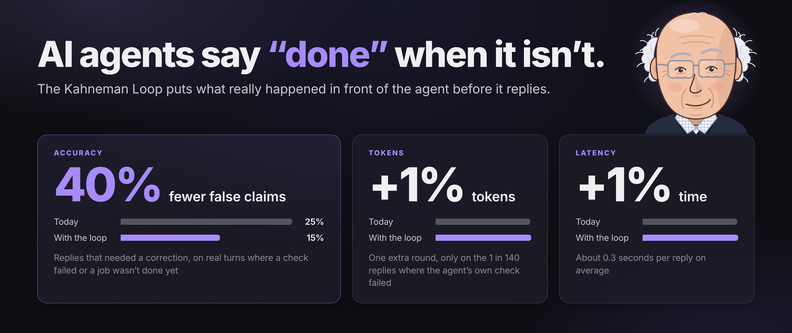

# The Kahneman Loop (System 1.5)



**AI agents say "done" when it isn't.** The deploy hadn't finished, or the test the agent just ran had failed, and
it tells the user it's fixed anyway. The Kahneman Loop puts what really happened in front of the agent before
it replies, and hands its own failed check back once before it can say "done".

> **With the Kahneman Loop, our agents made 40% fewer false claims, for about 1% more tokens and 1% more time.**

That's measured on real production traffic. On turns where a check had failed or a job wasn't done yet,
replies that needed a correction fell from **25% to 15%**. The cost is averaged over every reply: the
only extra work is one more model round on the 1 in 140 replies where the agent's own check failed,
which comes to about 0.3 seconds per reply. It's one file with zero dependencies, and there's a drop-in
Stop hook for Claude Code.

A *false claim* here is a claim that a tool result contradicts ("all tests pass" after a red test run)
or that no tool result backs ("I tested it" when nothing was tested). The failure has a few names
already: outcome hallucination, hallucinated success, illusory completion (see [Related work](#related-work)).

**Why "System 1.5".** Daniel Kahneman described the mind as two systems: a fast one that jumps to a
conclusion from whatever is in front of it, and a slow one that can check that conclusion but rarely
bothers unless something surprises it. An agent has both. What it lacks is the surprise when its own
evidence says it's wrong. The Kahneman Loop is that missing piece. It does no thinking of its own: it
shows the fast system the fact it was missing, and when the agent's own check failed, it calls the slow
system in, once. [Background](#background-how-people-jump-to-conclusions) has the psychology, and
[How it works](#how-it-works-system-15) has the code.

## Background: how people jump to conclusions

### The availability heuristic

In 1973, Amos Tversky and Daniel Kahneman showed that people judge how common or likely something is
by how easily examples come to mind. Ask whether English has more words that *start* with K or more
words with K as the *third* letter, and most people say "start with K", because those words are easier
to recall. There are actually more of the second kind.

### System 1 and System 2

Kahneman later folded that finding, and decades of others, into one picture of the mind
(*Thinking, Fast and Slow*, 2011). It has two characters.

- **System 1** is fast and automatic. It reads a face, finishes "bread and ...", and turns whatever is
  in front of it into a story that makes sense, with no effort and no feeling of having done anything.
  The availability heuristic is System 1 at work.
- **System 2** is slow and deliberate. It does long division, checks an argument and follows a rule it
  was given. It can catch System 1's mistakes, but it's expensive, and Kahneman calls it lazy: most of
  the time it endorses whatever System 1 hands it.

Try this: *a bat and a ball cost $1.10 together. The bat costs $1.00 more than the ball. How much does
the ball cost?* The answer that comes to mind is 10 cents. It's wrong (the ball costs 5 cents), and
Kahneman reports that more than half of the students asked at Harvard, MIT and Princeton gave it anyway.
System 2 could have checked it in a few seconds. It didn't, because nothing felt wrong.

That's the part that matters here: **System 2 doesn't decide for itself when to look.** System 1 calls
it in when it runs into trouble, such as a question it has no answer for, or a surprise that breaks the
story it was telling.

### WYSIATI: What You See Is All There Is

System 1 builds the most coherent story it can from the information in front of it and doesn't ask
what's missing. Kahneman's name for this is **WYSIATI: What You See Is All There Is**. Confidence comes
from how well the story hangs together, not from how complete the evidence is.

That's what makes a missing fact so dangerous: it can't surprise anyone. A fact that contradicts the
story wakes System 2 up. A fact that isn't in view does nothing at all.

## Why agents say "done"

An LLM writing a reply works like System 1: it writes the most coherent continuation of what's in its
context. Its "mind" is the context window, and what's available is what stands out in it: what's
recent, what's repeated and what's near the end. This has been measured: language models use
information at the start and end of a long context much better than information in the middle.

Now look at the moment an agent writes the reply that ends a turn. Two things are reliably in view: its
own plan ("fix the login bug, deploy it, done"), which it has restated many times, and the last tool
result. Two things reliably aren't:

- **What a tool result didn't establish.** `{"jobId":"d_81","status":"starting"}` doesn't say the
  deploy finished. The agent reads "deploy" and writes "it's live".
- **A check that failed twenty steps ago.** The test run that came back red is in the middle of a long
  context. The plan is right here. The agent writes "fixed, all tests pass".

So it tells the most coherent story it can see, and that story is "done". The agent isn't lying. It's
WYSIATI.

The agent does have a System 2. It can run the test again, read the logs or open the page, and a
reasoning model can think at length before it answers. What it doesn't have is the surprise that would
send it looking, because nothing in view contradicts "done".

### Why a rule doesn't fix it, and neither does more thinking

Every turn we measured already ran with this line in the agent's instructions:

> **NEVER say "fixed"/"works"/"verified"/"I tested it" unless a tool call you just made returned a real success.**

A quarter of the affected replies still needed a correction. A rule is a note to System 2 far up the
context, and System 2 only reads it when something sends it looking. Turning up reasoning on every reply
pays System 2's price on every reply, including the many where nothing went wrong, and the reasoning
starts from the same context, where the failed check is still twenty steps back.

## How it works: System 1.5

The Kahneman Loop sits between the two systems. It's code in your harness, not another model, and it
does no thinking of its own. It does the two things System 1 can't do for itself: show the missing
fact, and raise the surprise when the agent's own evidence says the story is wrong.

**1. Show the missing fact: verdict-first tool results.** WYSIATI can't be argued with, so change what's
seen. A tool result that doesn't establish the outcome says so in its first field, in plain words:

```diff
- {"jobId":"d_81","status":"starting"}
+ {"verified":false,"verdict":"NOT live yet: this job is \"starting\". It is live only when its status is \"done\".","jobId":"d_81","status":"starting"}
```

The same goes for a check that couldn't run (`NOT checked: the page did not render`) and a call
that was refused (`NOT checked: the call was refused before anything ran: ...`).

**2. Raise the surprise: hand back once.** When the agent is about to end its turn and one of its own
checks from this turn is still failing (no later run of the same check passed), the turn isn't over. The
failure goes back to the agent as one message, and that is what calls System 2 in: the agent runs the
check again, fixes the cause, or says plainly that it failed. The answer to that message is the reply
the user reads, so the message asks for the whole reply, not just the fix. An agent told only to say
what it changed says only that, and the user never hears what else the turn did:

```
tool   npm test                 -> Exit code 1 ... 1 failing
       ... 14 more steps ...
agent  "Fixed the login bug, all tests pass."
       [System: your own check this turn came back failed: npm test (1 failing). A failed check is
        not done, whatever the reply says. Fix the cause and run the check again. If you cannot fix
        it, say plainly that it failed and why. ...]
agent  (runs the test, fixes the cause, runs it again)
       "Fixed: the password check compared hashes in the wrong order. Tests pass now (12 passing)."
```

The surprise is the failed check, not the wording of the reply, so it works in every language. (No text
rule we tried could tell bad replies from fine ones; see [eval/RESULTS.md](eval/RESULTS.md).) It fires
once per turn, never in a loop: System 2 is called in, not left running. On turns where no check
failed, there's no extra round at all.

The [Ralph loop](https://ghuntley.com/ralph/) keeps an agent going round on the same task. The Kahneman
Loop is a single extra round, and only when the agent's own check says the story is wrong.

## Use it

### Claude Code: one hook

```bash
git clone https://github.com/VibeKit-Bot/kahneman-loop ~/kahneman-loop
```

Add to `.claude/settings.json` in your project (or `~/.claude/settings.json` for every project):

```json
{
  "hooks": {
    "Stop": [{ "hooks": [{ "type": "command", "command": "node ~/kahneman-loop/claude-code/stop-hook.mjs" }] }]
  }
}
```

When Claude is about to stop and a check it ran this turn is still failing (tests, build, typecheck,
lint, `cargo`, `go`, `pytest`, `curl -f`, and so on), the hook hands the failure back once. A later
passing run of the same check clears it. Denied or blocked calls don't count as failures. The hook
only reads the transcript and never runs anything. To change what counts as a check, edit `CHECK_RE`
at the top of [claude-code/stop-hook.mjs](claude-code/stop-hook.mjs).

### Your own agent harness: copy one file

Copy [kahneman-loop.ts](kahneman-loop.ts) into your harness. Node 22.6+ runs it as is, and any TypeScript
toolchain compiles it. There are three touch points:

```ts
import { CheckLedger, jobVerdict, runTurnWithHandBack, verdict, withVerdict } from './kahneman-loop';

// 1. In your tool executor: put the verdict first on results that don't establish the outcome.
const job = await startDeploy(app);
const v = jobVerdict(job, { what: 'live', done: ['running'], failed: ['failed'] });
return withVerdict(job, v.verdict, v.verified);

// A check that couldn't look:
if (!shot.ok) return withVerdict(shot, verdict.notChecked('the page did not render'));

// 2. Also in the executor: record every check the agent runs (one ledger per turn).
ledger.record(`click ${selector}`, changed, changed ? undefined : 'the click did not change anything');

// 3. Around the turn: hand a standing failure back once.
const { reply } = await runTurnWithHandBack({
  messages,
  ledger,
  run: msgs => runAgentLoop(msgs),
  continueWith: (reply, fact) => [
    { role: 'assistant', content: reply },
    { role: 'user', content: fact },
  ],
  language: user.language,
});
```

If your loop doesn't fit `runTurnWithHandBack`, call `handBack({ failures: ledger.standingFailures(),
alreadyHandedBack })` where your turn ends. It returns the message to send, or `null`. Pass `recheck`
to name how your harness runs the check again, and `note` for anything that gets past the failure
(a saved test login, say). The note goes in exactly as you write it; failure names are clipped and lose
their brackets, since they come from what the check saw. If your harness hands back evidence of its
own, such as a page it loaded, end that message with `replyReplaced()` so the answer is written the
same way.

## Results

These numbers come from production traffic on [VibeKit](https://vibekit.bot), a hosted agent that
builds and runs apps, over three weeks in October 2026. Each affected turn was replayed with its
real context on the same model. Arm A got today's tool results, and arm B got the Kahneman Loop's
results plus the hand-back. Each arm got two samples. A blind judge scored every reply on its own, shuffled,
against what the tools really did. Full method: [eval/METHOD.md](eval/METHOD.md).

| | Replies needing correction: today | With the Kahneman Loop | Drop, points (95% CI) |
|---|---:|---:|---:|
| **All affected turns** | 25% | **15%** | **10 (4 to 18)** |
| Turns where the original reply was wrong | 57% | 29% | 28 (12 to 43) |
| Turns where the original reply was already right (no harm) | 8% | 7% | 1 (-4 to 7) |
| Hand-back turns | 30% | 0% (went back to work every time) | 30 (15 to 46) |
| Verdict text only | 23% | 18% | 5 (-2 to 13) |

- **Tokens: about 1% more.** A verdict adds about 86 tokens to a tool result that didn't establish
  its outcome. The hand-back adds one more model round on about 1 in 140 replies. Averaged over every
  reply, that's under 1% more tokens.
- **Time: about 1% more.** Verdicts add no calls and no waiting. The hand-back round is the agent going
  back to fix what failed; spread over every reply, it's about 0.3 seconds, under 1%. VibeKit already
  runs the same hand-back in production, so these are the real tokens and seconds of those rounds
  over the same three weeks, scaled to how often the Kahneman Loop's hand-back fires.
- **No harm on good turns:** where the original reply was already right, the loop didn't add mistakes
  (8% needed correction today, 7% with the loop).
- **Reach:** about 6% of all turns were affected. Across all turns, that's about 1 in 200 replies
  that no longer needs correcting.

### What this doesn't show

- **Verdict text alone isn't proven.** Its confidence interval crosses zero. The clear win comes from
  verdicts plus the hand-back together.
- **What happened after a hand-back wasn't measured.** In every sample the agent went back to work
  instead of replying, so it never repeated the false claim. Its later reply was not replayed. If you
  count only samples that ended in a reply, the rate is 28% today and 17% with the loop.
- **The data comes from one platform and one month.** The mix was app building, deploys and UI
  checks, with several models. Your traffic may differ, so [measure it](eval/).
- **The judge is a model** (Claude Sonnet 5.5, a fixed rubric, blind to which arm wrote each reply).
  No human labeled these replies.
- **The replay isn't perfect.** The regenerated "today" arm matched the original reply's verdict on
  80% of turns.
- **The Claude Code hook is a port** of the same mechanism to Claude Code. It wasn't measured on
  Claude Code itself.
- **It can only be surprised by a check that ran.** A claim that nothing checked ("I tested it" when no
  test ran) has no failure to hand back. The loop has its own WYSIATI: it sees what the harness recorded.
- **System 1 and System 2 are an analogy.** They describe people, and Kahneman himself called them
  fictitious characters. Nothing here claims a model has them. The loop was measured, not derived from
  the analogy.

## Measure it on your own agent

[eval/](eval/) contains the replay and judge method as a stdlib-only script that works with any
OpenAI-compatible endpoint. It dry-runs by default and prints the number of calls before it spends
anything. See [eval/METHOD.md](eval/METHOD.md).

## Tests

```bash
node --test test/*.test.*
```

## Related work

Others have named and measured the same failure. What the Kahneman Loop adds is the trigger (the agent's
own failed check, not the wording of its reply) and a measured cost on production traffic.

- **Illusory completion.** "When Is Enough Not Enough? Illusory Completion in Search Agents",
  [arXiv:2602.07549](https://arxiv.org/abs/2602.07549), 2026. Search agents stop before they have
  checked every part of the question. Their fix keeps a ledger of what is still unverified, updated
  by an extra model call at each step: up to 11.6 points more accuracy and 26.5 points fewer
  under-verified answers. The cost of those calls isn't reported.
- **Outcome hallucination.** [TestMu AI on agent action hallucination](https://www.testmuai.com/learning-hub/agent-action-hallucination/).
  When a tool returned a success-shaped "accepted" payload, the agent reported "done" 10 times out of
  10; an explicit error brought that to 0 of 10 (one model, 10 trials). That's the same idea as
  verdict-first results.
- **Hallucinated success.** Tian Pan, ["The Hallucinated Success Problem: When Your Agent Says Done and
  Means Nothing"](https://tianpan.co/blog/2026-04-23-hallucinated-success-agent-false-completion), 2026.
  Proposes checker agents and assertions on side effects before a "done" is accepted. Not measured.


## Further reading

- Amos Tversky and Daniel Kahneman, "Availability: A heuristic for judging frequency and probability",
  *Cognitive Psychology* 5(2), 1973.
- Daniel Kahneman, *Thinking, Fast and Slow*, 2011. System 1 and System 2 are introduced in chapter 1,
  "The Characters of the Story"; the bat and the ball and the lazy System 2 are in chapter 3, "The Lazy
  Controller"; WYSIATI is in chapter 7, "A Machine for Jumping to Conclusions".
- Shane Frederick, "Cognitive Reflection and Decision Making", *Journal of Economic Perspectives* 19(4),
  2005. The source of the bat-and-ball question.
- Nelson F. Liu et al., "Lost in the Middle: How Language Models Use Long Contexts",
  [arXiv:2307.03172](https://arxiv.org/abs/2307.03172), 2023.

## License

MIT
